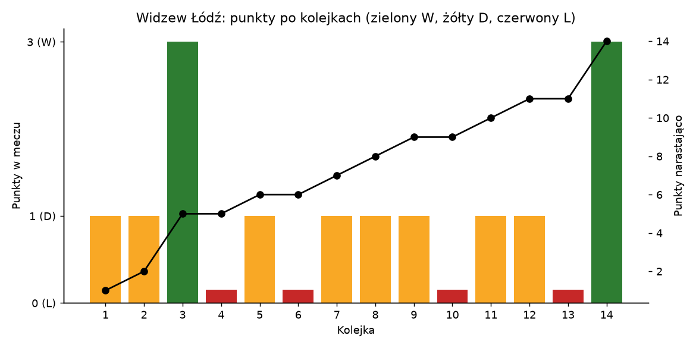
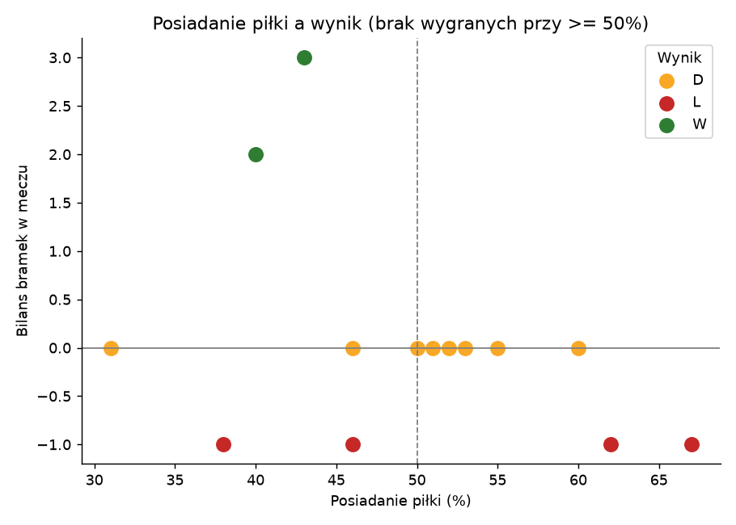

# RTS – analiza Widzewa Łódź

Projekt zbiera statystyki RTS Widzew Łódź z serwisu [FBref](https://fbref.com), czyści je w Pythonie
i na ich podstawie analizuje formę drużyny w sezonie 2026/27 Ekstraklasy
(stan: 14 kolejek, 2026-11-14).

**Wnioski z analizy:** [analiza_wynikow.md](analiza_wynikow.md)

## Najważniejsze wyniki

Bilans po 14 kolejkach: 2 W, 8 D, 4 L, 14 punktów, bramki 20:19.



Widzew zremisował 8 meczów, a 12 z 14 spotkań rozstrzygnęło się różnicą najwyżej jednego gola.
Drużyna nie wygrała żadnego z 8 meczów, w których miała co najmniej 50% posiadania piłki.



Pozostałe wykresy są w folderze [`wykresy/`](wykresy): bramki, ustawienia, strzały zawodników i kartki.

## Struktura projektu

```
RTS/
├── analiza_wynikow.md       # wnioski i rekomendacje
├── analiza_python/
│   └── wykresy.py           # generuje wykresy z data_clean/
├── wykresy/                 # wygenerowane wykresy PNG
├── data_raw/                # surowe dane ze scrapera
├── data_clean/              # dane po czyszczeniu (CSV)
├── scripts_python/
│   ├── scraper_mecze.py       # statystyki zawodników
│   ├── scraper_terminarz.py   # terminarz i wyniki meczów
│   ├── scraper_dodatkowe.py   # strzały, bramkarze, czas gry, faule, logi meczowe
│   └── cleaner_mecze.py       # czyszczenie surowych danych
└── requirements.txt
```

## Uruchomienie

Wymagany jest Python 3.10+ i przeglądarka Chrome (tylko dla scraperów).

```bash
python -m venv .venv
.venv\Scripts\activate          # Windows
# source .venv/bin/activate     # Linux / macOS
pip install -r requirements.txt
```

### Wykresy (nie wymaga pobierania danych)

Dane są już w repozytorium w `data_clean/`, więc wystarczy:

```bash
python analiza_python/wykresy.py
```

Wykresy zapisują się w folderze `wykresy/`.

### Odświeżenie danych

Skrypty używają ścieżek względnych, więc uruchamiaj je z folderu `scripts_python`:

```bash
cd scripts_python
python scraper_mecze.py        # surowe dane do data_raw/
python cleaner_mecze.py        # czyszczenie do data_clean/
python scraper_terminarz.py
python scraper_dodatkowe.py
```

`scraper_terminarz.py` zapisuje `widzew_terminarz_czysty.csv` w `data_raw/`. Plik trzeba ręcznie
przenieść do `data_clean/`, bo stamtąd korzysta z niego `wykresy.py`.

Scrapery otwierają okno Chrome. FBref chroni się Cloudflare, więc trzeba rozwiązać
zabezpieczenie w przeglądarce, poczekać na załadowanie strony i wcisnąć ENTER w konsoli.

## Dane i ograniczenia

- Źródło: FBref. Dla Ekstraklasy nie ma xG ani minut goli.
- 14 meczów to mała próba, więc wnioski są sygnałami, a nie dowodami.
- W tabelach zawodników FBref występują wiersze zbiorcze (`Squad Total`, `Opponent Total`), które trzeba
  pomijać przy analizie na poziomie zawodników.

## Technologie

Python, pandas, matplotlib, Selenium.
